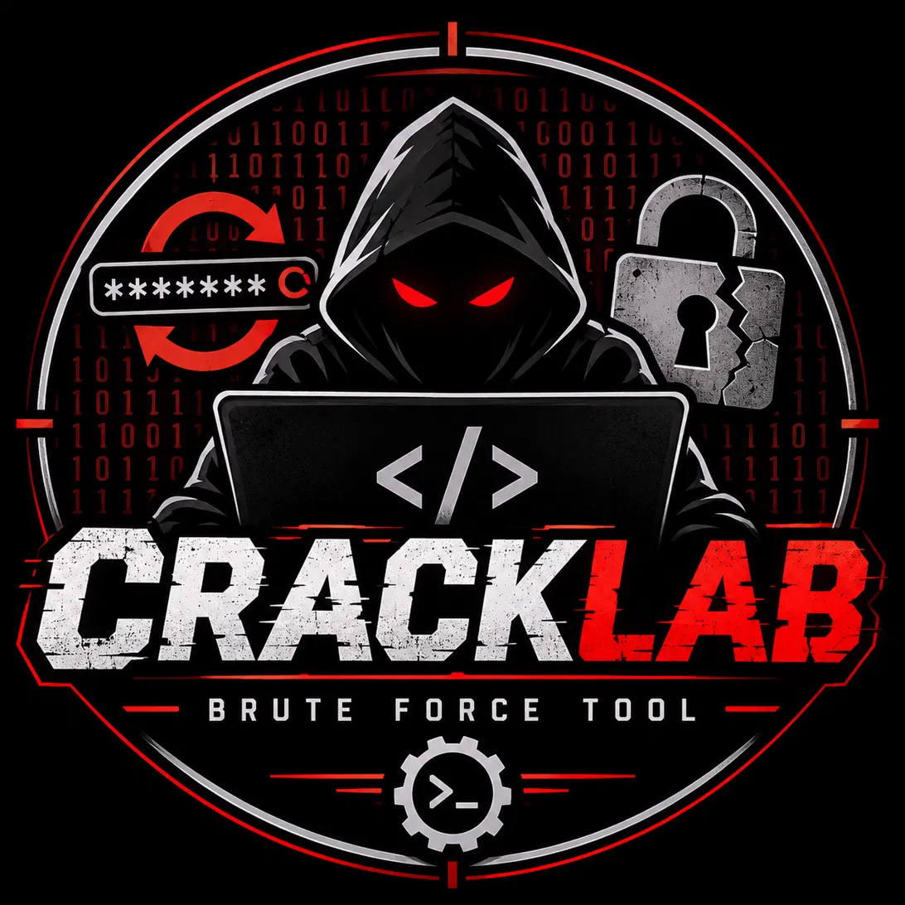
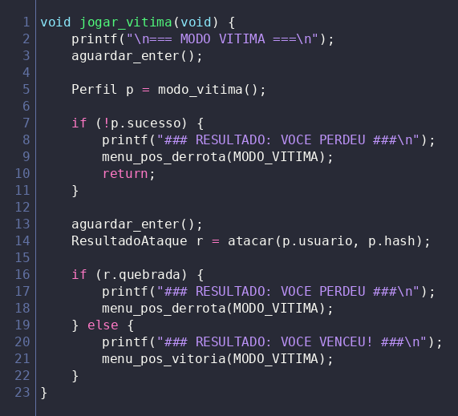
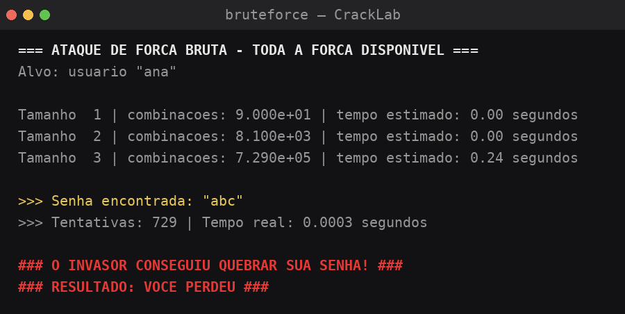
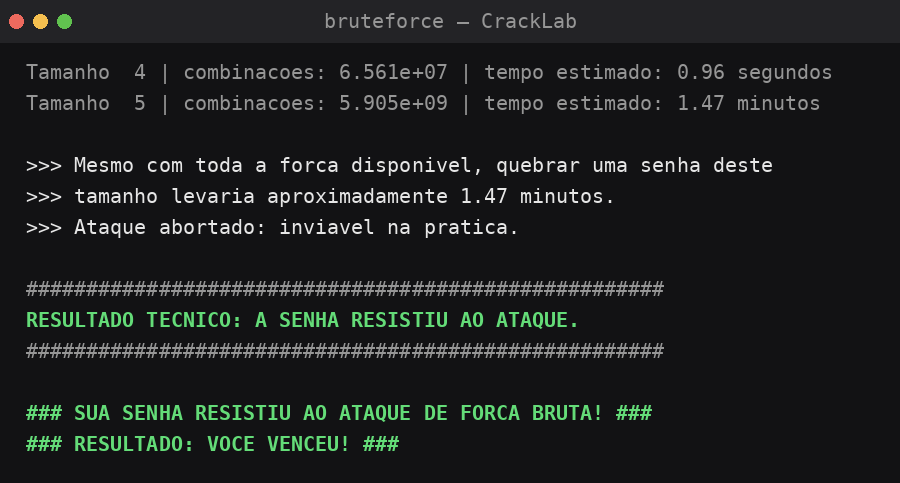
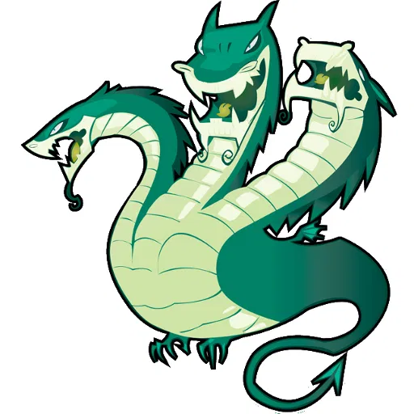

 <p align="center">
  
</p>

<h1 align="center">CrackLab</h1>

<p align="center">
  <strong>Break passwords. Understand security.</strong>
</p>

<p align="center">
  Educational Password Security & Brute-Force Simulation in C
</p>

---

# 🇧🇷 Português

## Índice

1. [Sobre o projeto](#sobre-o-projeto)
2. [Objetivos](#objetivos)
3. [Como jogar](#como-jogar)
4. [Como o CrackLab funciona](#como-o-cracklab-funciona)
5. [Arquitetura e estrutura do código](#arquitetura-e-estrutura-do-código)
6. [Capturas de tela](#capturas-de-tela)
7. [Bibliotecas utilizadas](#bibliotecas-utilizadas)
8. [Ambiente de desenvolvimento](#ambiente-de-desenvolvimento)
9. [Inspiração: THC-Hydra](#inspiração-thc-hydra)
10. [Desafios durante o desenvolvimento](#desafios-durante-o-desenvolvimento)
11. [Possíveis atualizações](#possíveis-atualizações)
12. [Segurança e limitações](#segurança-e-limitações)
13. [Créditos e documentação](#créditos-e-documentação)

---

## Sobre o projeto

O **CrackLab** é um projeto educacional de cibersegurança desenvolvido em linguagem C, criado para explorar a segurança de senhas por meio de simulações de força bruta, análise de resistência de senhas e conceitos de autenticação.

A proposta é transformar um conceito de segurança da informação em uma experiência interativa, na qual o jogador pode assumir dois papéis diferentes:

- **Vítima:** responsável por criar uma senha que consiga resistir às tentativas de descoberta.
- **Invasor:** responsável por tentar descobrir a senha utilizando uma simulação de força bruta.

O objetivo é demonstrar, de maneira prática, como o comprimento e a variedade de caracteres influenciam a resistência de uma senha diante de diferentes possibilidades de ataque.

Tudo acontece localmente, dentro de um único programa, sem conexão com a internet e sem interação com contas ou sistemas externos.

Afinal, descobrir que sua senha é fraca dentro de um laboratório é bem melhor do que descobrir isso quando alguém já está dentro da sua conta.

## Objetivos

O desenvolvimento do CrackLab possui objetivos tanto educacionais quanto técnicos.

**Objetivos relacionados à cibersegurança:**

- Compreender o funcionamento conceitual de ataques de força bruta.
- Explorar a importância de senhas longas e variadas.
- Demonstrar como o espaço de combinações influencia o tempo de descoberta.
- Compreender conceitos relacionados a hashes e autenticação.
- Diferenciar ataques de força bruta de outras técnicas de descoberta de senhas.

**Objetivos relacionados à programação:**

- Desenvolver habilidades práticas em linguagem C.
- Trabalhar com funções, estruturas e manipulação de strings.
- Compreender a comunicação entre diferentes arquivos `.c` e `.h`.
- Aplicar conceitos de modularização.
- Trabalhar com bibliotecas padrão e recursos POSIX.
- Desenvolver raciocínio lógico e resolução de problemas.

## Como jogar

O CrackLab apresenta um menu principal com três opções:

1. Vítima
2. Invasor
3. Sair

### Modo Vítima

Neste modo, o jogador assume o papel de alguém que precisa proteger seu perfil.

O funcionamento é simples:

1. O jogador informa um nome de usuário.
2. O cronômetro de 60 segundos é iniciado.
3. Durante esse período, o jogador deve criar uma senha.
4. Após a definição da senha, o programa inicia a simulação de força bruta.
5. O resultado indica se a senha foi descoberta ou se resistiu ao modelo de ataque utilizado.

### Modo Invasor

Neste modo, o jogador assume o papel de quem tenta descobrir uma senha.

O funcionamento é um pouco diferente:

1. Um bot gera uma senha automaticamente.
2. A senha pode apresentar diferentes níveis de complexidade.
3. O jogador pode aguardar o processo ou digitar `manual` para consultar as explicações sobre o funcionamento da ferramenta.
4. Após a preparação, o motor de força bruta inicia a simulação.
5. O programa apresenta o resultado da tentativa.

### Resultados

O resultado depende da senha utilizada e dos limites estabelecidos pela simulação.

Uma senha curta pode ser descoberta rapidamente, enquanto uma senha com maior espaço de busca pode exigir um número muito elevado de tentativas.

Quando o espaço de busca ultrapassa os limites práticos definidos pelo programa, a simulação interrompe a busca e apresenta uma estimativa de tempo.

**Importante:** o resultado representa o comportamento do modelo implementado no CrackLab, não uma garantia de que determinada senha seja impossível de descobrir.

## Como o CrackLab funciona

Para entender o funcionamento do projeto, podemos imaginar o CrackLab como um pequeno laboratório dividido em três departamentos.

Cada departamento possui uma responsabilidade específica.

**1. `menu.c` | O centro de operações**

É o ponto de entrada do programa e responsável pela interação com o jogador.

Suas responsabilidades incluem:

- Apresentar o menu principal.
- Receber as escolhas do jogador.
- Controlar o fluxo da partida.
- Encaminhar as informações aos módulos responsáveis.
- Apresentar os resultados.

**2. `perfil.c` | A criação do perfil**

É responsável pela preparação das informações utilizadas na simulação.

Suas responsabilidades incluem:

- Receber o nome de usuário.
- Permitir a criação de uma senha pelo jogador.
- Gerar senhas automaticamente no modo Invasor.
- Preparar os dados necessários para a comparação durante o ataque.

O projeto utiliza um valor derivado da senha, chamado hash, para realizar as comparações entre a senha original e as tentativas.

**3. `bruteforce.c` | O motor de ataque**

Aqui acontece a parte principal da simulação.

O módulo é responsável por:

- Gerar combinações de caracteres.
- Testar possíveis senhas.
- Calcular os valores correspondentes às tentativas.
- Comparar os resultados com o valor de referência.
- Estimar o espaço de busca e o tempo necessário para percorrê-lo.
- Interromper a simulação quando os limites definidos são atingidos.

O funcionamento segue a lógica de testar diferentes possibilidades até encontrar uma correspondência ou concluir que a busca ultrapassou os limites estabelecidos.

Uma observação interessante: o programa não precisa passar anos testando combinações para apresentar um resultado. A matemática permite estimar o tamanho do espaço de busca antes de executar todas as tentativas.

Ou seja, o CrackLab não precisa esperar a aposentadoria para descobrir que uma senha é complicada.

## Arquitetura e estrutura do código

O projeto utiliza uma arquitetura modular, separando as responsabilidades entre diferentes arquivos.

```text
CrackLab/
│
├── assets/
│   ├── cracklab_logo_transp.png
│   ├── term_menu.png
│   ├── term_ataque_quebrado.png
│   ├── term_vitoria.png
│   └── hydra_logo.png
│
├── CMakeLists.txt
│
├── menu.c
│
├── perfil.c
├── perfil.h
│
├── bruteforce.c
├── bruteforce.h
│
├── README.md
│
└── Documentação/
```

### Responsabilidade dos arquivos

| Arquivo | Responsabilidade |
|---|---|
| `menu.c` | Menu e controle principal |
| `perfil.c` | Criação e preparação dos perfis |
| `perfil.h` | Declarações públicas do módulo de perfil |
| `bruteforce.c` | Motor de simulação de força bruta |
| `bruteforce.h` | Declarações públicas do motor |
| `CMakeLists.txt` | Configuração da compilação |

A separação permite organizar melhor o código, facilitar a manutenção e desenvolver cada parte sem concentrar todas as funcionalidades em um único arquivo.

## Capturas de tela

### Menu principal

<p align="center">
  
</p>

<p align="center">
  <em>Interface inicial e opções de jogo.</em>
</p>

### Senha descoberta

<p align="center">
  
</p>

<p align="center">
  <em>Exemplo de uma senha curta sendo descoberta durante a simulação.</em>
</p>

### Senha resistente

<p align="center">
  
</p>

<p align="center">
  <em>Exemplo de uma senha cujo espaço de busca ultrapassa os limites práticos da simulação.</em>
</p>

## Bibliotecas utilizadas

O CrackLab utiliza bibliotecas da linguagem C e recursos do ambiente POSIX.

| Biblioteca | Aplicação |
|---|---|
| `<stdio.h>` | Entrada e saída de dados |
| `<stdlib.h>` | Funções utilitárias e geração de valores aleatórios |
| `<string.h>` | Manipulação de strings |
| `<ctype.h>` | Classificação de caracteres |
| `<time.h>` | Medição de tempo |
| `<unistd.h>` | Recursos POSIX |
| `<sys/select.h>` | Monitoramento de entrada e cronômetro |
| `<math.h>` | Operações matemáticas e cálculo de combinações |

## Ambiente de desenvolvimento

O desenvolvimento do CrackLab foi organizado utilizando o **CLion**, IDE da JetBrains.

A escolha está relacionada principalmente aos recursos disponíveis para programação em C.

**Principais recursos utilizados ou considerados:**

- **Editor inteligente:** facilita a escrita e a navegação pelo código.
- **Depurador:** permite acompanhar a execução e investigar problemas.
- **CMake:** auxilia na configuração e organização da compilação.
- **Integração com Git:** facilita o controle de versões e o gerenciamento do repositório.
- **Navegação entre arquivos:** permite trabalhar com diferentes módulos `.c` e `.h`.

O projeto também utiliza recursos POSIX, portanto seu funcionamento depende de um ambiente compatível com essas interfaces.

## Inspiração: THC-Hydra

<p align="center">
  
</p>

Uma das referências conceituais do CrackLab é o **THC-Hydra**, ferramenta conhecida no universo de testes de invasão e auditoria de segurança.

O Hydra é utilizado em avaliações autorizadas de autenticação em diferentes serviços de rede, incluindo SSH, FTP, HTTP e outros protocolos.

O CrackLab utiliza essa referência como inspiração para estudar a lógica de tentativas sistemáticas de descoberta de senhas.

Entretanto, existe uma diferença fundamental:

- **THC-Hydra:** ferramenta de auditoria capaz de interagir com serviços de autenticação.
- **CrackLab:** projeto educacional local que simula a lógica de descoberta de senhas sem realizar conexões externas.

A proposta não é substituir ferramentas profissionais, mas oferecer um ambiente simples para estudar conceitos fundamentais de segurança de autenticação.

## Desafios durante o desenvolvimento

O desenvolvimento do CrackLab também envolveu problemas que exigiram investigação, testes e alterações na estrutura do programa.

Alguns dos principais desafios foram:

**1. Comunicação entre processos**

Em uma versão inicial, os módulos funcionavam como programas separados e utilizavam arquivos e chamadas `system()` para compartilhar informações.

Essa abordagem provocava problemas com a entrada de teclado e a comunicação entre os processos.

A solução foi reorganizar o projeto em um único executável, utilizando chamadas de funções e estruturas para transportar informações entre os módulos.

**2. Tratamento de entradas inesperadas**

O menu apresentava problemas quando a entrada do teclado terminava inesperadamente.

Foi necessário implementar um tratamento específico para evitar que o programa permanecesse em um loop sem conseguir receber novas informações.

**3. Organização da documentação**

Durante a elaboração dos relatórios técnicos, surgiram problemas relacionados à formatação e à disposição das imagens nos documentos.

Foram realizados ajustes para melhorar a apresentação e a legibilidade dos arquivos.

**4. Preparação da identidade visual**

O símbolo do CrackLab também passou por ajustes para remover o fundo indesejado e preservar os detalhes originais da arte.

Esses desafios fizeram parte do processo de desenvolvimento e contribuíram para o aprimoramento do projeto.

## Possíveis atualizações

O CrackLab poderá receber novas funcionalidades conforme o desenvolvimento e os estudos avançarem.

Algumas possibilidades são:

- [ ] Adicionar um indicador visual de força da senha.
- [ ] Permitir configurar o tempo do cronômetro.
- [ ] Permitir configurar os conjuntos de caracteres utilizados.
- [ ] Implementar um histórico de partidas.
- [ ] Criar um placar de vitórias e derrotas.
- [ ] Desenvolver uma interface gráfica.
- [ ] Adicionar efeitos sonoros e melhorias visuais.
- [ ] Implementar seleção de idioma.
- [ ] Criar testes automatizados.
- [ ] Adicionar modo multiplayer local.
- [ ] Explorar outras técnicas educacionais de análise de senhas.

As funcionalidades acima representam possibilidades de evolução, não recursos necessariamente presentes na versão atual.

## Segurança e limitações

O CrackLab foi desenvolvido exclusivamente para fins educacionais.

Algumas limitações importantes:

- Não realiza ataques contra contas ou serviços externos.
- Não estabelece conexões com servidores.
- Não utiliza credenciais reais de usuários.
- Não substitui ferramentas profissionais de auditoria.
- As estimativas de tempo dependem dos parâmetros e limites da simulação.
- O hash utilizado no projeto não deve ser considerado um mecanismo de armazenamento seguro de senhas para aplicações reais.

Para compreender a segurança de senhas em sistemas de produção, também é necessário estudar mecanismos como Argon2id, bcrypt e scrypt, além de controles como limitação de tentativas e autenticação multifator.

**O objetivo do CrackLab é aprender, experimentar e compreender. Não comprometer sistemas.**

## Créditos e documentação

Projeto desenvolvido para o repositório **Cybermota**, com foco no aprendizado de programação em C e conceitos de cibersegurança.

Além deste README, o projeto conta com documentos complementares:

| Documento | Descrição |
|---|---|
| `CrackLab_Relatorio_PT-BR.md` | Relatório técnico em português |
| `CrackLab_Report_EN-GB.md` | Relatório técnico em inglês britânico |
| `CrackLab_Relatorio_Colaboracao_IA.md` | Relatório de colaboração com IA |
| `CrackLab_Report_Collaboration_AI_EN-GB.md` | Relatório de colaboração com IA em inglês britânico |

### Utilização de Inteligência Artificial

A Inteligência Artificial foi utilizada como ferramenta de apoio durante o desenvolvimento, auxiliando na construção do código-base, na investigação de problemas, na revisão e na elaboração da documentação.

A participação da IA e as etapas de colaboração estão descritas nos relatórios específicos do projeto.

O desenvolvimento também envolve estudo, revisão, testes e aprimoramento manual do código.

---

# 🇬🇧 English (UK)

## Table of Contents

1. [About the project](#about-the-project-1)
2. [Objectives](#objectives)
3. [How to play](#how-to-play)
4. [How CrackLab works](#how-cracklab-works)
5. [Code architecture and file structure](#code-architecture-and-file-structure)
6. [Screenshots](#screenshots)
7. [Libraries used](#libraries-used-1)
8. [Development environment](#development-environment)
9. [Inspiration: THC-Hydra](#inspiration-thc-hydra)
10. [Development challenges](#development-challenges)
11. [Possible future updates](#possible-future-updates)
12. [Security and limitations](#security-and-limitations)
13. [Credits and documentation](#credits-and-documentation-1)

---

## About the project

**CrackLab** is an educational cybersecurity project developed in C, designed to explore password security through brute-force simulations, password strength analysis and authentication concepts.

The idea is to turn a cybersecurity concept into an interactive experience in which the player can take on two different roles:

- **Victim:** responsible for creating a password that can withstand discovery attempts.
- **Attacker:** responsible for attempting to discover the password using a brute-force simulation.

The objective is to demonstrate how password length and character variety influence resistance against different password attack possibilities.

Everything runs locally within a single programme, without an internet connection or interaction with external accounts and systems.

After all, discovering that your password is weak in a laboratory is considerably better than discovering it when someone is already inside your account.

## Objectives

CrackLab has both educational and technical objectives.

**Cybersecurity objectives:**

- Understand the fundamental concepts behind brute-force attacks.
- Explore the importance of long and varied passwords.
- Demonstrate how the search space influences password discovery time.
- Understand concepts related to hashing and authentication.
- Distinguish brute-force attacks from other password discovery techniques.

**Programming objectives:**

- Develop practical C programming skills.
- Work with functions, structures and string manipulation.
- Understand communication between different `.c` and `.h` files.
- Apply modular programming concepts.
- Work with standard libraries and POSIX resources.
- Develop logical reasoning and problem-solving skills.

## How to play

CrackLab features a main menu with three options:

1. Victim
2. Attacker
3. Exit

### Victim Mode

In this mode, the player takes the role of someone who needs to protect their profile.

The process is straightforward:

1. The player enters a username.
2. A 60-second countdown begins.
3. During this period, the player must create a password.
4. Once the password has been submitted, the programme starts the brute-force simulation.
5. The result indicates whether the password was discovered or resisted the attack model.

### Attacker Mode

In this mode, the player takes the role of someone attempting to discover a password.

The process works slightly differently:

1. A bot automatically generates a password.
2. The generated password may have different levels of complexity.
3. The player can wait for the process or type `manual` to read an explanation of how the attack tool works.
4. Once preparation is complete, the brute-force engine starts the simulation.
5. The programme displays the outcome.

### Results

The result depends on the password and the limits established by the simulation.

A short password may be discovered quickly, whereas a password with a larger search space may require an extremely high number of attempts.

When the search space exceeds the practical limits defined by the programme, the simulation stops and provides a time estimate.

**Important:** the result represents the behaviour of CrackLab's implemented model, not a guarantee that a particular password is impossible to discover.

## How CrackLab works

To understand how the project operates, imagine CrackLab as a small laboratory divided into three departments.

Each department has a specific responsibility.

**1. `menu.c` | The operations centre**

This is the programme's entry point and handles interaction with the player.

Its responsibilities include:

- Displaying the main menu.
- Receiving the player's choices.
- Controlling the game flow.
- Passing information to the appropriate modules.
- Displaying the results.

**2. `perfil.c` | Profile creation**

This module prepares the information used in the simulation.

Its responsibilities include:

- Receiving the username.
- Allowing the player to create a password.
- Automatically generating passwords in Attacker Mode.
- Preparing the data required for comparison during the attack.

The project uses a value derived from the password, known as a hash, to compare the original password with the generated attempts.

**3. `bruteforce.c` | The attack engine**

This is where the main simulation takes place.

The module is responsible for:

- Generating character combinations.
- Testing possible passwords.
- Calculating the corresponding values for each attempt.
- Comparing the results with the reference value.
- Estimating the search space and the time required to explore it.
- Stopping the simulation when the defined limits are reached.

The process follows the logic of testing different possibilities until a match is found or the search exceeds the established limits.

An interesting point: the programme does not need to spend years testing combinations to present a result. Mathematics allows it to estimate the size of the search space before performing every possible attempt.

In other words, CrackLab does not need to wait until retirement to realise that a password is complicated.

## Code architecture and file structure

The project uses a modular architecture, separating responsibilities across different files.

```text
CrackLab/
│
├── assets/
│   ├── cracklab_logo_transp.png
│   ├── term_menu.png
│   ├── term_ataque_quebrado.png
│   ├── term_vitoria.png
│   └── hydra_logo.png
│
├── CMakeLists.txt
│
├── menu.c
│
├── perfil.c
├── perfil.h
│
├── bruteforce.c
├── bruteforce.h
│
├── README.md
│
└── Documentation/
```

### File responsibilities

| File | Responsibility |
|---|---|
| `menu.c` | Main menu and programme control |
| `perfil.c` | Profile creation and preparation |
| `perfil.h` | Public declarations for the profile module |
| `bruteforce.c` | Brute-force simulation engine |
| `bruteforce.h` | Public declarations for the engine |
| `CMakeLists.txt` | Build configuration |

This separation makes the code easier to organise, maintain and develop without concentrating every feature in a single file.

## Screenshots

### Main menu

<p align="center">
  
</p>

<p align="center">
  <em>The initial interface and available game options.</em>
</p>

### Password discovered

<p align="center">
  
</p>

<p align="center">
  <em>An example of a short password being discovered during the simulation.</em>
</p>

### Resistant password

<p align="center">
  
</p>

<p align="center">
  <em>An example of a password whose search space exceeds the practical limits of the simulation.</em>
</p>

## Libraries used

CrackLab uses C language libraries and POSIX environment resources.

| Library | Application |
|---|---|
| `<stdio.h>` | Input and output |
| `<stdlib.h>` | Utility functions and random value generation |
| `<string.h>` | String manipulation |
| `<ctype.h>` | Character classification |
| `<time.h>` | Time measurement |
| `<unistd.h>` | POSIX resources |
| `<sys/select.h>` | Input monitoring and countdown |
| `<math.h>` | Mathematical operations and combination calculations |

## Development environment

CrackLab was organised using **CLion**, an IDE developed by JetBrains.

The choice was mainly based on the tools available for C programming.

**Main features used or considered:**

- **Smart editor:** makes writing and navigating code easier.
- **Debugger:** allows execution to be monitored and problems investigated.
- **CMake:** helps configure and organise the build process.
- **Git integration:** simplifies version control and repository management.
- **File navigation:** makes working across different `.c` and `.h` modules easier.

The project also uses POSIX resources, so its operation depends on a compatible environment.

## Inspiration: THC-Hydra

<p align="center">
  
</p>

One of CrackLab's conceptual references is **THC-Hydra**, a well-known tool in penetration testing and security auditing.

Hydra is used in authorised authentication assessments across different network services, including SSH, FTP, HTTP and other protocols.

CrackLab uses this reference as inspiration to study the logic behind systematic password discovery attempts.

However, there is one fundamental difference:

- **THC-Hydra:** an auditing tool capable of interacting with authentication services.
- **CrackLab:** a local educational project that simulates password discovery without establishing external connections.

The aim is not to replace professional tools, but to provide a simple environment for studying fundamental authentication security concepts.

## Development challenges

CrackLab's development also involved problems that required investigation, testing and changes to the programme's structure.

Some of the main challenges included:

**1. Communication between processes**

In an early version, the modules operated as separate programmes and used files and `system()` calls to share information.

This approach caused keyboard input and communication problems between processes.

The solution was to reorganise the project into a single executable, using function calls and structures to transfer information between modules.

**2. Handling unexpected input**

The menu had problems when keyboard input ended unexpectedly.

Specific handling was required to prevent the programme from remaining in a loop without being able to receive new information.

**3. Documentation organisation**

During the preparation of technical reports, formatting and image placement problems appeared.

Adjustments were made to improve the presentation and readability of the documents.

**4. Visual identity preparation**

The CrackLab symbol also underwent adjustments to remove an unwanted background while preserving the original artwork's details.

These challenges were part of the development process and contributed to improving the project.

## Possible future updates

CrackLab may receive additional features as development and learning progress.

Some possible improvements include:

- [ ] Add a visual password-strength indicator.
- [ ] Allow countdown duration to be configured.
- [ ] Allow the character sets used in attacks to be configured.
- [ ] Implement a match history.
- [ ] Create a wins and losses scoreboard.
- [ ] Develop a graphical interface.
- [ ] Add sound effects and visual improvements.
- [ ] Implement language selection.
- [ ] Create automated tests.
- [ ] Add local multiplayer mode.
- [ ] Explore other educational password analysis techniques.

These features represent possible future developments and are not necessarily available in the current version.

## Security and limitations

CrackLab was developed exclusively for educational purposes.

Some important limitations:

- It does not attack external accounts or services.
- It does not establish connections to servers.
- It does not use real user credentials.
- It does not replace professional auditing tools.
- Time estimates depend on the simulation's parameters and limits.
- The hash used in the project should not be considered a secure password-storage mechanism for real applications.

To understand password security in production systems, it is also necessary to study mechanisms such as Argon2id, bcrypt and scrypt, alongside controls such as rate limiting and multi-factor authentication.

**CrackLab's purpose is to learn, experiment and understand. Not to compromise systems.**

## Credits and documentation

A project developed for the **Cybermota** repository, focusing on learning C programming and cybersecurity concepts.

In addition to this README, the project includes supplementary documents:

| Document | Description |
|---|---|
| `CrackLab_Relatorio_PT-BR.md` | Technical report in Portuguese |
| `CrackLab_Report_EN-GB.md` | Technical report in British English |
| `CrackLab_Relatorio_Colaboracao_IA.md` | AI collaboration report |
| `CrackLab_Report_Collaboration_AI_EN-GB.md` | AI collaboration report in British English |

### Use of Artificial Intelligence

Artificial Intelligence was used as a supporting tool during development, assisting with the creation of the base code, problem investigation, review and documentation.

The AI's contribution and the collaboration process are described in the project's dedicated reports.

The development process also involves studying, reviewing, testing and manually improving the code.

---

<p align="center">
  <strong>CrackLab | Cybermota</strong>
  <br>
  Break passwords. Understand security.
</p>
