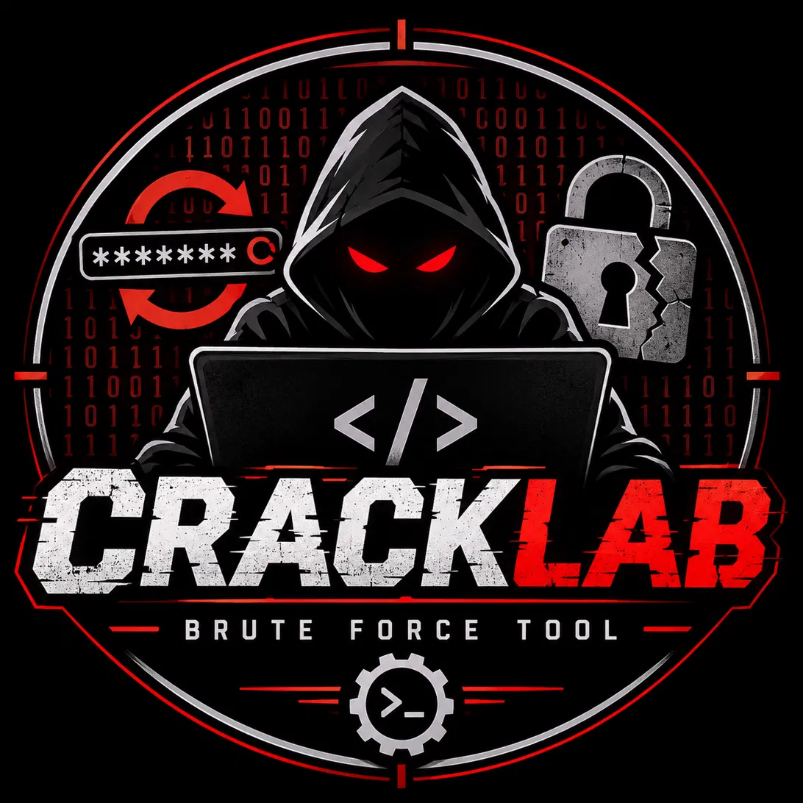
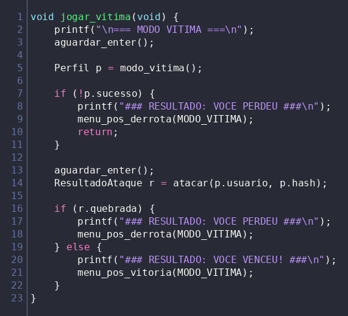
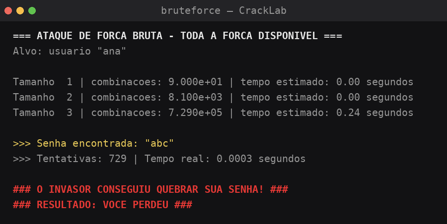
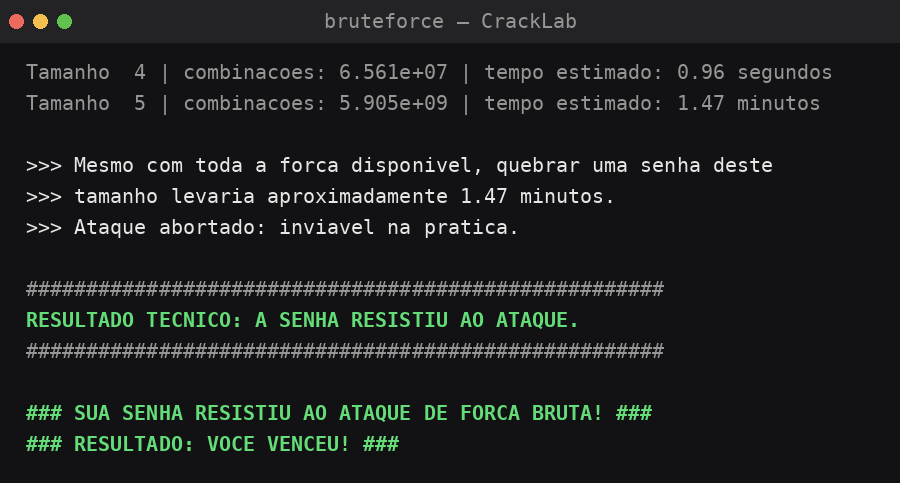
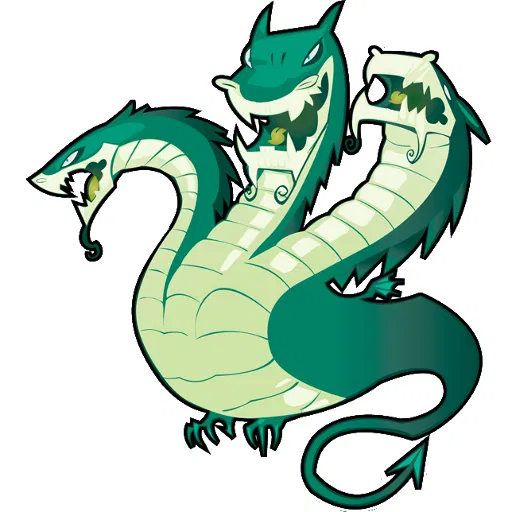

  <p align="center">
  
</p>

<h1 align="center">CrackLab</h1>

<p align="center">
  <strong>Break passwords. Understand security.</strong>
</p>

<p align="center">
  Educational Password Security & Brute-Force Simulation in C
</p>

<p align="center">
  
  
  
  
</p>

---

# 🇧🇷 Português Brasileiro

## 📑 Índice

1. [Sobre o projeto](#-sobre-o-projeto)
2. [Objetivos](#-objetivos)
3. [Funcionalidades](#-funcionalidades)
4. [Como jogar](#-como-jogar)
5. [Como o CrackLab funciona](#-como-o-cracklab-funciona)
6. [Arquitetura e estrutura do código](#-arquitetura-e-estrutura-do-código)
7. [Capturas de tela](#-capturas-de-tela)
8. [Bibliotecas e tecnologias](#-bibliotecas-e-tecnologias)
9. [Instalação e execução](#-instalação-e-execução)
10. [Inspiração: THC-Hydra](#-inspiração-thc-hydra)
11. [Desafios e evolução do desenvolvimento](#-desafios-e-evolução-do-desenvolvimento)
12. [Próximas atualizações](#-próximas-atualizações)
13. [Segurança e limitações](#-segurança-e-limitações)
14. [Documentação técnica](#-documentação-técnica)
15. [Inteligência Artificial](#-inteligência-artificial)
16. [Créditos](#-créditos)

---

## 🔐 Sobre o projeto

O **CrackLab** é um projeto educacional de cibersegurança desenvolvido em linguagem C. Seu objetivo é explorar conceitos relacionados à segurança de senhas, autenticação, análise de resistência e simulações de ataques de força bruta.

A proposta é transformar conceitos teóricos de segurança da informação em uma experiência interativa, na qual o jogador pode assumir dois papéis:

- **Vítima:** cria uma senha e tenta resistir à simulação de força bruta.
- **Cracker:** enfrenta uma senha gerada automaticamente pelo programa e tenta descobri-la.

O projeto funciona localmente, utilizando uma interface de terminal e sem estabelecer conexões com contas, servidores ou serviços externos.

Ao longo do desenvolvimento, o CrackLab evoluiu de uma implementação inicial para uma arquitetura modular, incorporando diferentes sistemas de configuração, tradução, avaliação de senhas e armazenamento de resultados.

A ideia central é demonstrar como o comprimento, a variedade de caracteres e o espaço de busca influenciam a resistência de uma senha.

Afinal, descobrir que sua senha é fraca dentro de um laboratório é bem melhor do que descobrir isso quando alguém já está dentro da sua conta.

## 🎯 Objetivos

O desenvolvimento do CrackLab possui objetivos educacionais e técnicos.

**Cibersegurança:**

- Compreender os conceitos fundamentais de ataques de força bruta.
- Explorar a importância de senhas longas e variadas.
- Entender como o espaço de combinações influencia a descoberta de senhas.
- Estudar conceitos de hashes e autenticação.
- Observar as diferenças entre uma simulação local e uma ferramenta real de auditoria.
- Compreender algumas limitações dos métodos utilizados para avaliar senhas.

**Programação:**

- Desenvolver habilidades práticas em linguagem C.
- Trabalhar com funções, estruturas, ponteiros e manipulação de strings.
- Aplicar conceitos de modularização utilizando arquivos `.c` e `.h`.
- Trabalhar com bibliotecas padrão e recursos POSIX.
- Implementar sistemas de configuração e internacionalização.
- Manipular arquivos para armazenamento persistente de informações.
- Desenvolver raciocínio lógico e resolução de problemas.

## ⚙️ Funcionalidades

O CrackLab reúne diferentes funcionalidades em uma aplicação de terminal.

| Funcionalidade | Descrição |
|---|---|
| 👤 Modo Vítima | Permite criar uma senha e testar sua resistência. |
| 💻 Modo Cracker | Utiliza uma senha gerada automaticamente para a simulação. |
| 🔓 Brute Force Engine | Motor responsável por testar combinações de caracteres. |
| 🔑 Avaliação de senha | Analisa comprimento e variedade de caracteres. |
| 🌍 Multilíngue | Disponibiliza sete idiomas. |
| ⚙️ Dificuldade | Permite escolher entre Easy, Ok e Hard. |
| 🏆 Placar | Registra vitórias e derrotas do jogador e dos dois lados da disputa. |
| 📜 Histórico | Armazena partidas e permite consultar os resultados anteriores. |
| 🔁 Revanche | Permite iniciar outra partida sem reiniciar o programa. |
| 📊 Estatísticas | Exibe tentativas realizadas e tempo gasto na simulação. |
| 📖 Manual | Apresenta explicações sobre o funcionamento da simulação. |

### 🌍 Idiomas disponíveis

O sistema de internacionalização permite selecionar um dos sete idiomas disponíveis:

| Código | Idioma |
|---|---|
| 🇧🇷 PT-BR | Português Brasileiro |
| 🇵🇹 PT-PT | Português Europeu |
| 🇺🇸 EN-US | Inglês Americano |
| 🇬🇧 EN-GB | Inglês Britânico |
| 🇪🇸 ES | Espanhol |
| 🇨🇳 ZH | Chinês Mandarim |
| 🇫🇷 FR | Francês |

As mensagens do menu, das partidas, das avaliações e dos resultados são organizadas pelo módulo de idiomas.

### ⚙️ Níveis de dificuldade

O jogador pode escolher entre três dificuldades:

| Dificuldade | Tempo disponível |
|---|---:|
| 🟢 Easy | 60 segundos |
| 🟡 Ok | 30 segundos |
| 🔴 Hard | 10 segundos |

O tempo selecionado é utilizado no processo de criação de senha do Modo Vítima e na etapa de espera do Modo Cracker.

### 🏆 Placar e histórico

O CrackLab possui um sistema de pontuação que acompanha o desempenho das partidas.

O placar apresenta:

- Pontos da Vítima.
- Pontos do Cracker.
- Vitórias do jogador.
- Derrotas do jogador.

O histórico registra informações como:

- Data e horário da partida.
- Modo selecionado.
- Dificuldade utilizada.
- Resultado da partida.
- Número de tentativas.
- Tempo gasto na simulação.

Os registros são armazenados localmente no arquivo `cracklab_historico.txt`.

O programa mantém os dados em memória e apresenta as últimas 15 partidas na consulta do histórico.

## 🎮 Como jogar

Ao iniciar o CrackLab, o jogador encontra o menu principal com as opções de jogo, configurações e histórico.

### Menu principal

As opções disponíveis são:

| Opção | Ação |
|---|---|
| 1 | Iniciar Modo Vítima |
| 2 | Iniciar Modo Cracker |
| 3 | Alterar dificuldade |
| 4 | Alterar idioma |
| 5 | Consultar histórico |
| 6 | Sair |

### 👤 Modo Vítima

Neste modo, o jogador assume o papel de alguém que precisa proteger seu perfil.

**Funcionamento:**

1. O jogador informa um nome de usuário.
2. O programa apresenta o tempo disponível conforme a dificuldade escolhida.
3. O cronômetro é iniciado.
4. O jogador precisa criar uma senha antes que o tempo termine.
5. Após a criação, o sistema apresenta uma avaliação da senha.
6. O motor de força bruta inicia a simulação.
7. O resultado determina se a senha foi descoberta ou resistiu aos limites do modelo.

Se a senha resistir à simulação, a Vítima vence a partida.

Se a senha for descoberta, o Cracker recebe a pontuação.

### 💻 Modo Cracker

Neste modo, o jogador assume o papel de quem tenta descobrir uma senha.

**Funcionamento:**

1. O programa inicia a preparação da partida.
2. Um bot gera automaticamente uma senha.
3. O jogador aguarda o tempo correspondente à dificuldade selecionada.
4. Durante a espera, é possível digitar `manual` para consultar explicações sobre o funcionamento da ferramenta.
5. Após a preparação, o motor de força bruta inicia a simulação.
6. O resultado indica se a senha foi descoberta ou resistiu ao modelo de ataque.

Se a senha for descoberta, o jogador vence a partida.

Caso contrário, a Vítima recebe a pontuação.

### 🔁 Sistema de revanche

Após cada partida, o programa apresenta opções para continuar jogando.

Dependendo do resultado, o jogador pode:

- Repetir a partida no mesmo modo.
- Alternar para o Modo Vítima após uma derrota.
- Voltar ao menu principal.

O sistema utiliza um loop de execução para controlar as partidas sem depender de chamadas recursivas.

## 🧠 Como o CrackLab funciona

O funcionamento interno do projeto é dividido em módulos, cada um com uma responsabilidade específica.

### 1. `Menu.c` | Centro de operações

É o ponto de entrada da aplicação e o único arquivo que possui a função `main()`.

Responsabilidades:

- Apresentar o menu principal.
- Receber as escolhas do jogador.
- Controlar o fluxo das partidas.
- Gerenciar os modos Vítima e Cracker.
- Encaminhar informações entre os módulos.
- Registrar os resultados.
- Controlar os menus de revanche.

### 2. `Perfil.c` | Criação de perfis

Responsável pela preparação dos perfis e senhas utilizados nas partidas.

Responsabilidades:

- Receber o nome de usuário.
- Permitir a criação de uma senha.
- Controlar o cronômetro do Modo Vítima.
- Gerar senhas automaticamente no Modo Cracker.
- Avaliar o comprimento e a variedade de caracteres.
- Gerar o valor hash utilizado na simulação.

### 3. `Bruteforce.c` | Motor de força bruta

É o módulo responsável pela simulação de descoberta de senhas.

O motor utiliza um conjunto de caracteres composto por letras minúsculas, letras maiúsculas, números e símbolos.

Responsabilidades:

- Gerar combinações de caracteres.
- Testar candidatos de diferentes comprimentos.
- Comparar os hashes das tentativas com o hash de referência.
- Contabilizar o número de tentativas realizadas.
- Estimar o tamanho do espaço de busca.
- Calcular estimativas de tempo.
- Interromper a busca quando os limites definidos são atingidos.

O mecanismo percorre combinações de diferentes comprimentos, utilizando uma estimativa inicial de velocidade que é recalibrada com os dados obtidos durante a execução.

### 4. `Config.c` | Configurações

Responsável pelo gerenciamento das dificuldades.

O módulo mantém a dificuldade selecionada e disponibiliza o tempo correspondente para os outros componentes do programa.

### 5. `Idioma.c` | Internacionalização

Responsável pelo sistema de tradução.

As mensagens são organizadas por identificadores, permitindo que os módulos utilizem a mesma estrutura de comunicação independentemente do idioma selecionado.

O idioma atual é utilizado para apresentar menus, instruções, resultados e mensagens durante a execução.

### 6. `Placar.c` | Pontuação e histórico

Responsável pelo armazenamento e consulta dos resultados.

O módulo mantém os registros das partidas em memória e acrescenta novas informações ao arquivo `cracklab_historico.txt`.

Também calcula os pontos de cada lado e as vitórias e derrotas do jogador.

## 🗂️ Arquitetura e estrutura do código

O projeto utiliza uma arquitetura modular, separando as funcionalidades em diferentes arquivos.

```text
CrackLab/
│
├── assets/
│   ├── cracklab_logo_transp.png
│   ├── hydra_logo.png
│   ├── term_menu.png
│   ├── term_ataque_quebrado.png
│   └── term_vitoria.png
│
├── CrackLab/
│   ├── Menu.c
│   ├── Perfil.c
│   ├── Perfil.h
│   ├── Bruteforce.c
│   ├── Bruteforce.h
│   ├── Config.c
│   ├── Config.h
│   ├── Idioma.c
│   ├── Idioma.h
│   ├── Placar.c
│   ├── Placar.h
│   └── CMakeLists.txt
│
├── Documentation/
│   ├── CrackLab_Relatorio_PT-BR_v2.pdf
│   └── CrackLab_Report_EN-UK_v2.pdf
│
└── README.md
```

### Responsabilidade dos arquivos

| Arquivo | Responsabilidade |
|---|---|
| `Menu.c` | Entrada principal e controle do programa |
| `Perfil.c` | Criação de perfis, senhas e avaliação |
| `Perfil.h` | Estruturas e declarações do módulo de perfil |
| `Bruteforce.c` | Motor de simulação de força bruta |
| `Bruteforce.h` | Estruturas e declarações do motor |
| `Config.c` | Gerenciamento de dificuldade e tempo |
| `Config.h` | Declarações das configurações |
| `Idioma.c` | Implementação das traduções |
| `Idioma.h` | Idiomas disponíveis e identificadores de mensagens |
| `Placar.c` | Sistema de pontuação e histórico |
| `Placar.h` | Estruturas e declarações do placar |
| `CMakeLists.txt` | Configuração do processo de compilação |

A modularização facilita a manutenção, a organização e a evolução do código, evitando concentrar todas as funcionalidades em um único arquivo.

## 📸 Capturas de tela

### Menu principal

<p align="center">
  
</p>

<p align="center">
  <em>Menu inicial e opções disponíveis na aplicação.</em>
</p>

### Senha descoberta

<p align="center">
  
</p>

<p align="center">
  <em>Exemplo de uma senha descoberta durante a simulação.</em>
</p>

### Senha resistente

<p align="center">
  
</p>

<p align="center">
  <em>Exemplo de uma senha que ultrapassa os limites práticos definidos para a busca.</em>
</p>

## 🛠️ Bibliotecas e tecnologias

O CrackLab utiliza recursos da linguagem C e interfaces POSIX.

| Biblioteca / Tecnologia | Aplicação |
|---|---|
| `<stdio.h>` | Entrada, saída e manipulação de arquivos |
| `<stdlib.h>` | Funções utilitárias e geração de valores pseudoaleatórios |
| `<string.h>` | Manipulação de strings |
| `<ctype.h>` | Classificação e conversão de caracteres |
| `<time.h>` | Cronômetros e medição de tempo |
| `<unistd.h>` | Recursos POSIX |
| `<sys/select.h>` | Monitoramento de entrada e controle de espera |
| `<math.h>` | Cálculos matemáticos e estimativas de combinações |
| C11 | Padrão da linguagem utilizado |
| CMake | Sistema de configuração da compilação |
| CLion | Ambiente de desenvolvimento |

## 💻 Instalação e execução

### Requisitos

- Compilador C compatível com C11.
- Ambiente Linux ou compatível com POSIX.
- Biblioteca matemática do sistema.
- Git (opcional, para clonar o repositório).

### Clonando o repositório

```bash
git clone https://github.com/Udinocraft/CrackLab.git
cd CrackLab
```

### Compilação com GCC

A partir da pasta raiz do repositório:

```bash
gcc -std=c11 -Wall -Wextra -O2 CrackLab/*.c -lm -o cracklab
```

### Executando

```bash
./cracklab
```

O histórico das partidas será criado localmente no diretório de execução, utilizando o nome `cracklab_historico.txt`.

**Observação:** o projeto utiliza recursos POSIX, como `select()` e `unistd.h`. Portanto, ambientes sem suporte a essas interfaces podem exigir adaptações.

## 🐉 Inspiração: THC-Hydra

<p align="center">
  
</p>

Uma das referências conceituais do CrackLab é o **THC-Hydra**, ferramenta conhecida no universo de testes de invasão e auditoria de segurança.

O Hydra é utilizado em avaliações autorizadas de autenticação em diferentes serviços de rede, incluindo SSH, FTP, HTTP e outros protocolos.

O CrackLab utiliza essa referência como inspiração para estudar a lógica de tentativas sistemáticas de descoberta de senhas.

Entretanto, existe uma diferença fundamental entre os projetos:

| THC-Hydra | CrackLab |
|---|---|
| Ferramenta de auditoria de autenticação | Projeto educacional |
| Interage com serviços de rede | Funciona localmente |
| Utilizado em testes autorizados | Simula tentativas dentro do próprio programa |
| Possui suporte a diferentes protocolos | Utiliza um modelo próprio de força bruta |

O objetivo do CrackLab não é substituir ferramentas profissionais, mas oferecer um ambiente simples para estudar conceitos fundamentais de segurança de autenticação.

## 🧩 Desafios e evolução do desenvolvimento

O desenvolvimento do CrackLab envolveu diferentes etapas de implementação, investigação de problemas e reorganização do código.

**1. Comunicação entre módulos**

Uma das etapas importantes foi reorganizar a estrutura inicial, que utilizava programas separados e comunicação por arquivos e chamadas `system()`.

Essa abordagem provocava dificuldades na entrada de teclado e na comunicação entre processos.

A solução foi reorganizar o projeto em um único executável, utilizando funções e estruturas para compartilhar informações entre os módulos.

**2. Modularização**

Com o crescimento do projeto, tornou-se necessário separar as responsabilidades em diferentes arquivos.

Foram adicionados módulos específicos para configurações, idiomas, perfis, força bruta e pontuação.

Essa mudança tornou a estrutura mais organizada e facilitou a manutenção.

**3. Internacionalização**

A implementação de sete idiomas exigiu organizar as mensagens por identificadores, permitindo que diferentes módulos utilizassem traduções de forma consistente.

**4. Persistência de dados**

O sistema de histórico exigiu a criação de uma estrutura para registrar partidas e recuperar os dados quando o programa é iniciado novamente.

**5. Controle de tempo e entrada**

O uso de recursos POSIX permitiu implementar cronômetros e monitorar a entrada do teclado durante as etapas de espera.

Esses desafios contribuíram para o amadurecimento da arquitetura e para o aprendizado de conceitos importantes da programação em C.

## 🚀 Próximas atualizações

O CrackLab continuará evoluindo conforme o desenvolvimento e os estudos avançarem.

As próximas versões poderão incluir:

- [ ] Adicionar novos idiomas, ampliando a internacionalização.
- [ ] Desenvolver uma interface gráfica.
- [ ] Implementar um indicador visual de força da senha.
- [ ] Melhorar a apresentação das estatísticas.
- [ ] Aprimorar o sistema de configurações.
- [ ] Implementar testes automatizados.
- [ ] Melhorar a organização e a manutenção do código.
- [ ] Explorar novas técnicas educacionais de análise de senhas.

Esses itens representam possibilidades de evolução e não funcionalidades já disponíveis na versão atual.

## 🛡️ Segurança e limitações

O CrackLab foi desenvolvido exclusivamente para fins educacionais.

Algumas limitações técnicas importantes:

- Não realiza ataques contra contas ou serviços externos.
- Não estabelece conexões com servidores.
- Não utiliza credenciais reais de usuários.
- Não substitui ferramentas profissionais de auditoria.
- O motor de força bruta trabalha com candidatos de até 20 caracteres.
- As senhas geradas automaticamente pelo bot possuem comprimentos definidos dentro do próprio programa.
- A avaliação de força utiliza comprimento e variedade de caracteres, não sendo uma auditoria completa de segurança.
- As estimativas de tempo dependem da velocidade observada durante a execução e dos limites definidos no código.

### Sobre o hash utilizado

O projeto utiliza uma implementação didática do algoritmo **DJB2** para gerar valores de referência durante a simulação.

Esse algoritmo não é uma função criptográfica segura e pode apresentar colisões.

Portanto, ele não deve ser utilizado para armazenar senhas em aplicações reais.

Para sistemas de produção, é necessário estudar algoritmos próprios para armazenamento seguro de senhas, como:

- Argon2id.
- bcrypt.
- scrypt.

Também são importantes mecanismos como limitação de tentativas, autenticação multifator e políticas adequadas de autenticação.

**O objetivo do CrackLab é aprender, experimentar e compreender. Não comprometer sistemas.**

## 📚 Documentação técnica

Além deste README, o projeto possui relatórios técnicos complementares em português brasileiro e inglês britânico.

| Documento | Idioma |
|---|---|
| [`CrackLab_Relatorio_PT-BR_v2.pdf`](Documentation/CrackLab_Relatorio_PT-BR_v2.pdf) | 🇧🇷 Português Brasileiro |
| [`CrackLab_Report_EN-UK_v2.pdf`](Documentation/CrackLab_Report_EN-UK_v2.pdf) | 🇬🇧 English (UK) |

Os relatórios apresentam informações adicionais sobre o desenvolvimento, a arquitetura, os recursos implementados e os aspectos técnicos do projeto.

## 🤖 Inteligência Artificial

A Inteligência Artificial foi utilizada como ferramenta de apoio durante o desenvolvimento do CrackLab.

Sua utilização envolveu auxílio na construção do código-base, investigação de problemas, revisão de implementações e apoio à documentação.

O processo de desenvolvimento também envolveu estudo, análise, correções, testes e aprimoramento manual do código.

A utilização de IA é documentada de maneira transparente como parte do processo de desenvolvimento.

## 👨‍💻 Créditos

Projeto desenvolvido para o repositório **Cybermota**, com foco no aprendizado de programação em C e conceitos de cibersegurança.

**Desenvolvimento:** Udinocraft / Cybermota

---

# 🇬🇧 English (UK)

## 📑 Table of Contents

1. [About the project](#-about-the-project)
2. [Objectives](#-objectives)
3. [Features](#-features)
4. [How to play](#-how-to-play)
5. [How CrackLab works](#-how-cracklab-works)
6. [Code architecture and file structure](#-code-architecture-and-file-structure)
7. [Screenshots](#-screenshots)
8. [Libraries and technologies](#-libraries-and-technologies)
9. [Installation and execution](#-installation-and-execution)
10. [Inspiration: THC-Hydra](#-inspiration-thc-hydra)
11. [Development challenges and evolution](#-development-challenges-and-evolution)
12. [Future updates](#-future-updates)
13. [Security and limitations](#-security-and-limitations)
14. [Technical documentation](#-technical-documentation)
15. [Artificial Intelligence](#-artificial-intelligence)
16. [Credits](#-credits)

---

## 🔐 About the project

**CrackLab** is an educational cybersecurity project developed in C. Its purpose is to explore concepts related to password security, authentication, password strength analysis and brute-force simulations.

The idea is to turn theoretical information security concepts into an interactive experience in which the player can take on two different roles:

- **Victim:** creates a password and attempts to withstand the brute-force simulation.
- **Cracker:** faces a password automatically generated by the programme and attempts to discover it.

The project runs locally through a terminal interface, without establishing connections to external accounts, servers or services.

Throughout its development, CrackLab has evolved from an initial implementation into a modular architecture, incorporating configuration, translation, password evaluation and result-storage systems.

The main idea is to demonstrate how password length, character variety and search space influence password resistance.

After all, discovering that your password is weak in a laboratory is considerably better than discovering it when someone is already inside your account.

## 🎯 Objectives

CrackLab has both educational and technical objectives.

**Cybersecurity:**

- Understand the fundamental concepts behind brute-force attacks.
- Explore the importance of long and varied passwords.
- Understand how the combination space influences password discovery.
- Study hashing and authentication concepts.
- Observe the differences between a local simulation and a real auditing tool.
- Understand some of the limitations of password evaluation methods.

**Programming:**

- Develop practical C programming skills.
- Work with functions, structures, pointers and string manipulation.
- Apply modular programming using `.c` and `.h` files.
- Work with standard libraries and POSIX resources.
- Implement configuration and internationalisation systems.
- Handle files for persistent data storage.
- Develop logical reasoning and problem-solving skills.

## ⚙️ Features

CrackLab brings together several features in a terminal-based application.

| Feature | Description |
|---|---|
| 👤 Victim Mode | Allows the player to create a password and test its resistance. |
| 💻 Cracker Mode | Uses an automatically generated password for the simulation. |
| 🔓 Brute Force Engine | Engine responsible for testing character combinations. |
| 🔑 Password evaluation | Analyses password length and character variety. |
| 🌍 Multilingual support | Provides seven available languages. |
| ⚙️ Difficulty settings | Allows the player to choose Easy, Ok or Hard. |
| 🏆 Scoreboard | Tracks the player's wins and losses, as well as both sides' scores. |
| 📜 Match history | Stores previous matches and allows results to be reviewed. |
| 🔁 Rematch | Allows another match to begin without restarting the programme. |
| 📊 Statistics | Displays the number of attempts and time spent during the simulation. |
| 📖 Manual | Provides explanations about how the simulation works. |

### 🌍 Available languages

The internationalisation system allows the player to select one of seven languages:

| Code | Language |
|---|---|
| 🇧🇷 PT-BR | Brazilian Portuguese |
| 🇵🇹 PT-PT | European Portuguese |
| 🇺🇸 EN-US | American English |
| 🇬🇧 EN-GB | British English |
| 🇪🇸 ES | Spanish |
| 🇨🇳 ZH | Mandarin Chinese |
| 🇫🇷 FR | French |

Menu messages, match instructions, evaluations and results are organised through the language module.

### ⚙️ Difficulty levels

The player can choose between three difficulty levels:

| Difficulty | Available time |
|---|---:|
| 🟢 Easy | 60 seconds |
| 🟡 Ok | 30 seconds |
| 🔴 Hard | 10 seconds |

The selected time is used during password creation in Victim Mode and during the waiting stage in Cracker Mode.

### 🏆 Scoreboard and match history

CrackLab includes a scoring system that tracks match performance.

The scoreboard displays:

- Victim points.
- Cracker points.
- Player wins.
- Player losses.

The match history stores information such as:

- Match date and time.
- Selected game mode.
- Difficulty level.
- Match result.
- Number of attempts.
- Time spent during the simulation.

Records are stored locally in `cracklab_historico.txt`.

The programme keeps records in memory and displays the latest 15 matches when the history is opened.

## 🎮 How to play

When CrackLab starts, the player is presented with the main menu, including game modes, settings and match history.

### Main menu

The available options are:

| Option | Action |
|---|---|
| 1 | Start Victim Mode |
| 2 | Start Cracker Mode |
| 3 | Change difficulty |
| 4 | Change language |
| 5 | View match history |
| 6 | Exit |

### 👤 Victim Mode

In this mode, the player takes the role of someone who needs to protect their profile.

**How it works:**

1. The player enters a username.
2. The programme displays the available time according to the selected difficulty.
3. The countdown begins.
4. The player must create a password before time runs out.
5. Once the password has been created, the system displays a password evaluation.
6. The brute-force engine starts the simulation.
7. The result determines whether the password was discovered or resisted the model's limits.

If the password withstands the simulation, the Victim wins the match.

If the password is discovered, the Cracker receives the point.

### 💻 Cracker Mode

In this mode, the player takes the role of someone attempting to discover a password.

**How it works:**

1. The programme begins preparing the match.
2. A bot automatically generates a password.
3. The player waits for the time corresponding to the selected difficulty.
4. During the waiting period, the player can type `manual` to read explanations about how the tool works.
5. Once preparation is complete, the brute-force engine starts the simulation.
6. The result indicates whether the password was discovered or resisted the attack model.

If the password is discovered, the player wins the match.

Otherwise, the Victim receives the point.

### 🔁 Rematch system

After each match, the programme provides options for continuing.

Depending on the result, the player can:

- Repeat the match in the same mode.
- Switch to Victim Mode after a loss.
- Return to the main menu.

The system uses an execution loop to control matches without relying on recursive function calls.

## 🧠 How CrackLab works

The internal operation of the project is divided into modules, each with a specific responsibility.

### 1. `Menu.c` | Operations centre

This is the application's entry point and the only file containing the `main()` function.

Responsibilities:

- Display the main menu.
- Receive the player's choices.
- Control match flow.
- Manage Victim and Cracker modes.
- Transfer information between modules.
- Register match results.
- Control rematch menus.

### 2. `Perfil.c` | Profile creation

Responsible for preparing the profiles and passwords used in matches.

Responsibilities:

- Receive the username.
- Allow the player to create a password.
- Control the Victim Mode countdown.
- Automatically generate passwords in Cracker Mode.
- Evaluate password length and character variety.
- Generate the hash value used in the simulation.

### 3. `Bruteforce.c` | Brute-force engine

This module is responsible for the password discovery simulation.

The engine uses a character set consisting of lowercase letters, uppercase letters, numbers and symbols.

Responsibilities:

- Generate character combinations.
- Test candidates of different lengths.
- Compare attempt hashes against the reference hash.
- Count the number of attempts performed.
- Estimate the size of the search space.
- Calculate time estimates.
- Stop the search when the defined limits are reached.

The engine iterates through combinations of different lengths, using an initial speed estimate that is recalibrated with data collected during execution.

### 4. `Config.c` | Configuration

Responsible for managing difficulty settings.

The module stores the selected difficulty and provides the corresponding time to the other programme components.

### 5. `Idioma.c` | Internationalisation

Responsible for the translation system.

Messages are organised by identifiers, allowing different modules to use the same communication structure regardless of the selected language.

The current language is used to display menus, instructions, results and messages throughout execution.

### 6. `Placar.c` | Scoreboard and match history

Responsible for storing and reviewing match results.

The module keeps records in memory and appends new information to `cracklab_historico.txt`.

It also calculates each side's points and the player's wins and losses.

## 🗂️ Code architecture and file structure

The project uses a modular architecture, separating features into different files.

```text
CrackLab/
│
├── assets/
│   ├── cracklab_logo_transp.png
│   ├── hydra_logo.png
│   ├── term_menu.png
│   ├── term_ataque_quebrado.png
│   └── term_vitoria.png
│
├── CrackLab/
│   ├── Menu.c
│   ├── Perfil.c
│   ├── Perfil.h
│   ├── Bruteforce.c
│   ├── Bruteforce.h
│   ├── Config.c
│   ├── Config.h
│   ├── Idioma.c
│   ├── Idioma.h
│   ├── Placar.c
│   ├── Placar.h
│   └── CMakeLists.txt
│
├── Documentation/
│   ├── CrackLab_Relatorio_PT-BR_v2.pdf
│   └── CrackLab_Report_EN-UK_v2.pdf
│
└── README.md
```

### File responsibilities

| File | Responsibility |
|---|---|
| `Menu.c` | Main entry point and programme control |
| `Perfil.c` | Profile creation, passwords and evaluation |
| `Perfil.h` | Structures and declarations for the profile module |
| `Bruteforce.c` | Brute-force simulation engine |
| `Bruteforce.h` | Engine structures and declarations |
| `Config.c` | Difficulty and time management |
| `Config.h` | Configuration declarations |
| `Idioma.c` | Translation implementation |
| `Idioma.h` | Available languages and message identifiers |
| `Placar.c` | Scoreboard and match history |
| `Placar.h` | Scoreboard structures and declarations |
| `CMakeLists.txt` | Build configuration |

Modularisation makes the code easier to maintain, organise and extend, avoiding the need to concentrate every feature in a single file.

## 📸 Screenshots

### Main menu

<p align="center">
  
</p>

<p align="center">
  <em>Main menu and available application options.</em>
</p>

### Password discovered

<p align="center">
  
</p>

<p align="center">
  <em>Example of a password discovered during the simulation.</em>
</p>

### Resistant password

<p align="center">
  
</p>

<p align="center">
  <em>Example of a password that exceeds the practical limits defined for the search.</em>
</p>

## 🛠️ Libraries and technologies

CrackLab uses C language features and POSIX interfaces.

| Library / Technology | Application |
|---|---|
| `<stdio.h>` | Input, output and file handling |
| `<stdlib.h>` | Utility functions and pseudo-random value generation |
| `<string.h>` | String manipulation |
| `<ctype.h>` | Character classification and conversion |
| `<time.h>` | Countdown and time measurement |
| `<unistd.h>` | POSIX resources |
| `<sys/select.h>` | Input monitoring and waiting control |
| `<math.h>` | Mathematical calculations and combination estimates |
| C11 | C language standard |
| CMake | Build configuration system |
| CLion | Development environment |

## 💻 Installation and execution

### Requirements

- A C11-compatible compiler.
- Linux or a POSIX-compatible environment.
- The system mathematics library.
- Git (optional, for cloning the repository).

### Clone the repository

```bash
git clone https://github.com/Udinocraft/CrackLab.git
cd CrackLab
```

### Compile with GCC

From the repository root directory:

```bash
gcc -std=c11 -Wall -Wextra -O2 CrackLab/*.c -lm -o cracklab
```

### Run

```bash
./cracklab
```

The match history will be created locally in the execution directory, using the filename `cracklab_historico.txt`.

**Note:** the project uses POSIX resources such as `select()` and `unistd.h`. Environments without support for these interfaces may require adaptations.

## 🐉 Inspiration: THC-Hydra

<p align="center">
  
</p>

One of CrackLab's conceptual references is **THC-Hydra**, a well-known tool in penetration testing and security auditing.

Hydra is used in authorised authentication assessments across different network services, including SSH, FTP, HTTP and other protocols.

CrackLab uses this reference as inspiration to study the logic behind systematic password discovery attempts.

However, there is a fundamental difference between the projects:

| THC-Hydra | CrackLab |
|---|---|
| Authentication auditing tool | Educational project |
| Interacts with network services | Runs locally |
| Used in authorised assessments | Simulates attempts within the programme |
| Supports different protocols | Uses its own brute-force model |

The aim is not to replace professional tools, but to provide a simple environment for studying fundamental authentication security concepts.

## 🧩 Development challenges and evolution

CrackLab's development involved several stages of implementation, problem investigation and code restructuring.

**1. Communication between modules**

One important stage was restructuring the initial implementation, which used separate programmes and files and `system()` calls for communication.

This approach caused difficulties with keyboard input and inter-process communication.

The solution was to reorganise the project into a single executable, using functions and structures to share information between modules.

**2. Modularisation**

As the project grew, it became necessary to separate responsibilities into different files.

Dedicated modules were added for configuration, languages, profiles, brute force and scoring.

This change made the structure more organised and easier to maintain.

**3. Internationalisation**

Implementing seven languages required organising messages by identifiers, allowing different modules to use translations consistently.

**4. Data persistence**

The history system required a structure for recording matches and recovering data when the programme starts again.

**5. Time and input control**

The use of POSIX resources made it possible to implement countdowns and monitor keyboard input during waiting stages.

These challenges contributed to the architecture's development and helped build a stronger understanding of important C programming concepts.

## 🚀 Future updates

CrackLab will continue to evolve as development and learning progress.

Future versions may include:

- [ ] Add more languages and expand internationalisation.
- [ ] Develop a graphical interface.
- [ ] Implement a visual password-strength indicator.
- [ ] Improve the presentation of statistics.
- [ ] Enhance the configuration system.
- [ ] Implement automated tests.
- [ ] Improve code organisation and maintainability.
- [ ] Explore additional educational password analysis techniques.

These items represent possible future developments and are not features currently available in the project.

## 🛡️ Security and limitations

CrackLab was developed exclusively for educational purposes.

Some important technical limitations:

- It does not attack external accounts or services.
- It does not establish connections to servers.
- It does not use real user credentials.
- It does not replace professional auditing tools.
- The brute-force engine works with candidates of up to 20 characters.
- Automatically generated bot passwords have lengths defined within the programme.
- Password evaluation uses length and character variety, rather than a complete security audit.
- Time estimates depend on the execution speed observed and the limits defined in the code.

### About the hash function

The project uses an educational implementation of the **DJB2** algorithm to generate reference values during the simulation.

This algorithm is not a secure cryptographic hash function and may produce collisions.

Therefore, it must not be used to store passwords in real applications.

For production systems, it is necessary to study algorithms specifically designed for secure password storage, such as:

- Argon2id.
- bcrypt.
- scrypt.

Other important mechanisms include rate limiting, multi-factor authentication and appropriate authentication policies.

**CrackLab's purpose is to learn, experiment and understand. Not to compromise systems.**

## 📚 Technical documentation

In addition to this README, the project includes supplementary technical reports in Brazilian Portuguese and British English.

| Document | Language |
|---|---|
| [`CrackLab_Relatorio_PT-BR_v2.pdf`](Documentation/CrackLab_Relatorio_PT-BR_v2.pdf) | 🇧🇷 Brazilian Portuguese |
| [`CrackLab_Report_EN-UK_v2.pdf`](Documentation/CrackLab_Report_EN-UK_v2.pdf) | 🇬🇧 English (UK) |

The reports provide additional information about development, architecture, implemented features and the project's technical aspects.

## 🤖 Artificial Intelligence

Artificial Intelligence was used as a supporting tool during CrackLab's development.

Its use involved assistance with the creation of the code base, problem investigation, implementation review and documentation.

The development process also involved studying, analysing, correcting, testing and manually improving the code.

AI use is documented transparently as part of the development process.

## 👨‍💻 Credits

A project developed for the **Cybermota** repository, focusing on learning C programming and cybersecurity concepts.

**Development:** Udinocraft / Cybermota

---

<p align="center">
  <strong>CrackLab | Cybermota</strong>
  <br>
  Break passwords. Understand security.
</p>
